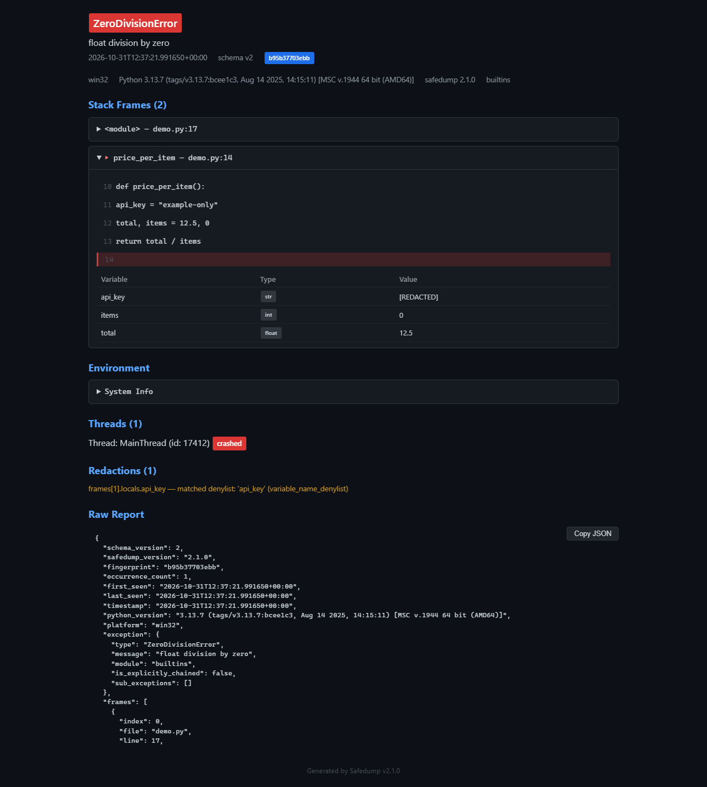
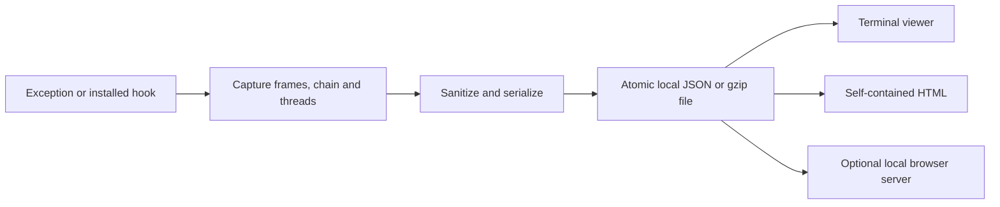

<div align="center">

# safedump

**Keep the debugging context after a Python crash.**

Capture local variables, exception chains and thread state. Inspect the report later, without a cloud service.

[](https://pypi.org/project/safedump/) [](https://github.com/Muneer320/safedump/actions/workflows/ci.yml) [](pyproject.toml) [](LICENSE)

[**Try it**](#capture-your-first-report) · [**Privacy controls**](#choose-what-you-capture) · [**Documentation**](#developer-desk)

</div>

## A traceback is the start of the investigation

A traceback points to the failing line. The next questions are usually about the values that reached it, the exception that led there and the state of other threads. safedump saves that context as local JSON, with redaction applied before writing, so the investigation can continue after the process has stopped.



*Real self-contained HTML export from safedump 2.1.0. The example uses a fake key; a supported `before_capture` hook removes machine-path metadata. Source context remains visible, including the example literal.*

| Capture the context | Control the detail | Read it your way |
| --- | --- | --- |
| Frame locals, exception chains, crash-site identity and thread state | Privacy tiers, name/pattern redaction, optional entropy detection and custom hooks | Structured JSON, optional Rich terminal viewer, self-contained HTML and a local browser UI |

> [!IMPORTANT]
> **Review every report before sharing it.** Automatic redaction reduces exposure; it cannot guarantee that a report is safe. Source lines, messages, paths and application-specific values can contain sensitive information, even at the lowest privacy tier.

## Capture your first report

Requires Python 3.9+. CI checks Python 3.9–3.13 on Linux and Windows. The capture library has no runtime dependencies; the optional viewer uses Rich.

```sh
python -m pip install "safedump[view]"
safedump --version
```

Save this as `demo.py`, then run `python demo.py`:

```python
import safedump

safedump.configure(output_dir="./crashes", include_env_names=False)

try:
    total, items = 12.5, 0
    unit_price = total / items
except ZeroDivisionError:
    report = safedump.capture_exception()
    print(f"Report saved: {report}")
```

The script prints the saved report path. Inspect its `ZeroDivisionError` and the captured `total`/`items` values:

```sh
safedump --dir ./crashes view
safedump --dir ./crashes view --html report.html
```

Open `report.html` in a browser. Reports stay in your chosen directory; no account or remote service is needed. The HTML export is self-contained.

For unhandled exceptions in an application, configure safedump before installing its hooks:

```python
import safedump

safedump.configure(preset="production", output_dir="./crashes")
safedump.install()
```

The hooks cover unhandled main-thread exceptions, worker-thread exceptions and unraisable exceptions. This is exception diagnostics, not a native process-crash/core-dump collector. `capture_exception()` returns a path or `None`; handle a failed write in applications that require confirmation.

## From exception to investigation



The capture path uses the standard library. Viewing happens after capture; Rich is optional and the terminal viewer falls back to plain text. The optional server accepts local browser connections; safedump does not upload reports or include telemetry.

## Choose what you capture

| Tier | Added detail |
| --- | --- |
| `0` | Stack/source context, exception chain and basic runtime metadata; no local values |
| `1` — default | Local values; optional environment names and command arguments |
| `2` | Expanded object attributes |
| `3` | Crash-site module globals |
| `4` | Environment variable values |

Presets can override tier, environment-name, argument and depth settings. Read the [configuration guide](docs/getting-started/configuration.md) and [privacy guide](docs/privacy.md) before enabling more detail. Entropy detection is opt-in. Reports can contain private data despite redaction; keep the optional web server on loopback and protect stored reports with OS permissions.

<details>
<summary><strong>CLI examples: filter, export, diagnose and inspect another directory</strong></summary>

```sh
safedump --dir ./crashes list --type ZeroDivisionError --since 7d
safedump --dir ./crashes view --json
safedump --dir ./crashes stats
safedump --dir ./crashes doctor
safedump --dir ./crashes serve --host 127.0.0.1 --port 4567
```

`--dir` takes precedence over `SAFEDUMP_DIR`, then the default `~/.safedump`. Use `safedump --help` and each subcommand's `--help` for all options. `safedump test` writes a synthetic report without first calling `install()`.

</details>

<details>
<summary><strong>Integrations and extension points</strong></summary>

- Public `watch()` context manager for scoped capture and re-raise.
- `register_serializer()` for custom types and `RedactionRule` for application-specific patterns.
- `before_capture` for report filtering; `on_crash` for your own post-capture callback.
- Explicit opt-in pytest plugin and Click/Typer integration.
- JSON/gzip reports, schema migration and programmatic `load_report()`.

See [integrations](docs/integrations.md), [API reference](docs/api.md) and [migration](docs/migration.md) for exact imports and compatibility guidance. User callbacks can perform their own work; the library's local capture behavior is not a restriction on application code.

</details>

## Developer desk

| Use and configure | Understand and contribute |
| --- | --- |
| [Published documentation](https://muneer320.github.io/safedump/) | [Architecture](docs/architecture.md) |
| [Quickstart](docs/getting-started/quickstart.md) | [Report format](docs/report-format.md) |
| [Configuration](docs/getting-started/configuration.md) | [Contributing and checks](CONTRIBUTING.md) |
| [Privacy](docs/privacy.md) | [Security reporting](SECURITY.md) |
| [Security boundaries](docs/security.md) | [Changelog](CHANGELOG.md) |

For development, clone the repository, run `python -m pip install -e ".[dev,view]"`, then `python -m pytest`. Run `ruff check .`, `ruff format --check .` and `mypy src/` before a code PR; the contributor guide covers the workflow. Report ordinary bugs in [Issues](https://github.com/Muneer320/safedump/issues). Follow the private [security-reporting policy](SECURITY.md) for vulnerabilities; never attach a sensitive report to a public issue.

Created by [Muneer Alam](https://github.com/Muneer320), with contributions preserved in the project history. [MIT license](LICENSE).
